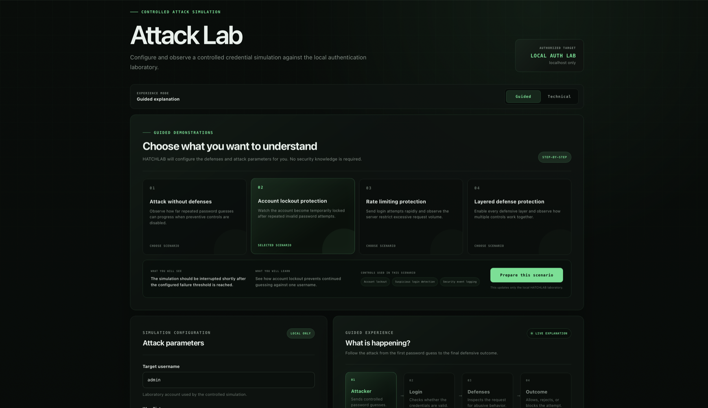
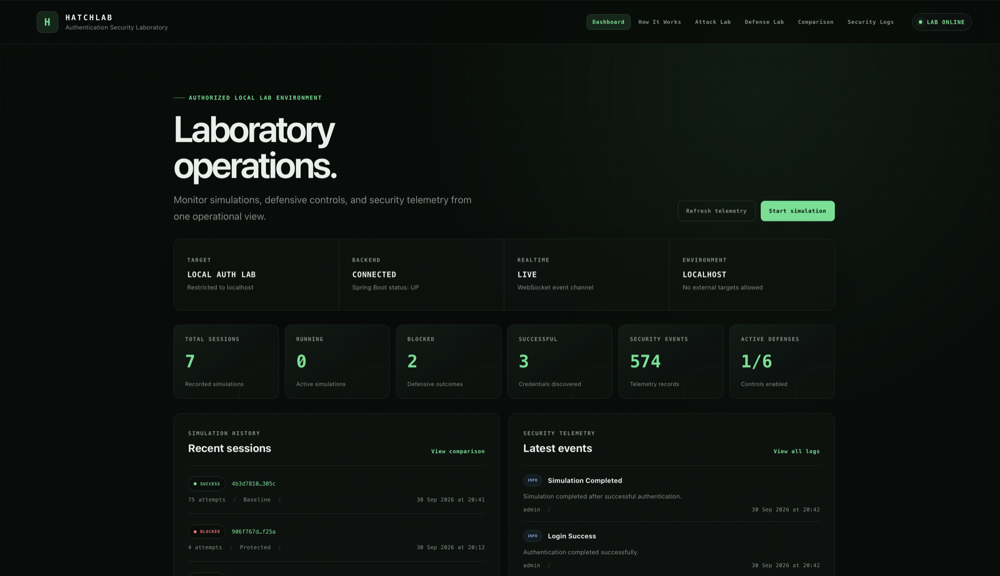
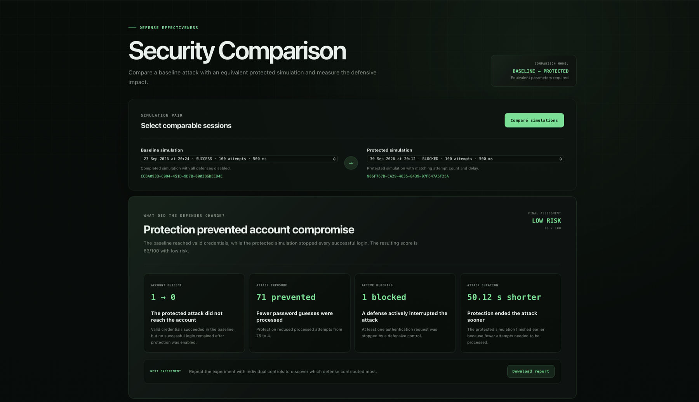
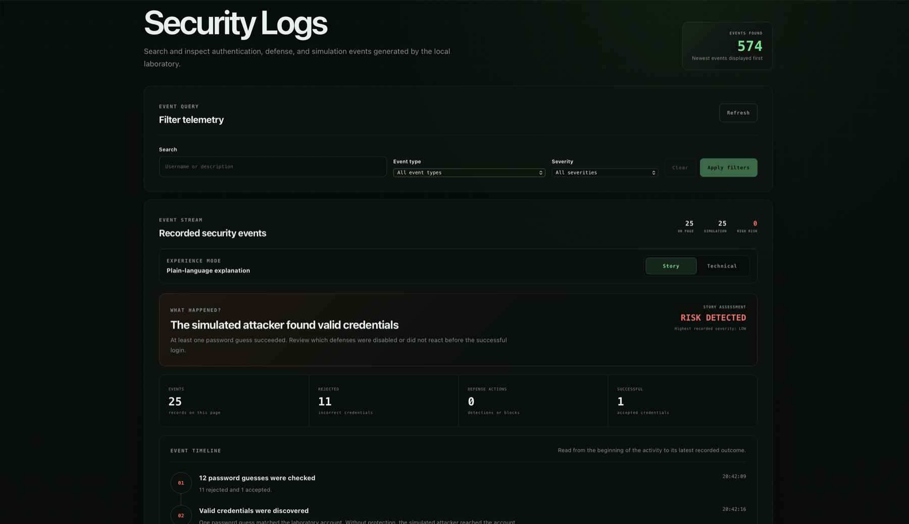
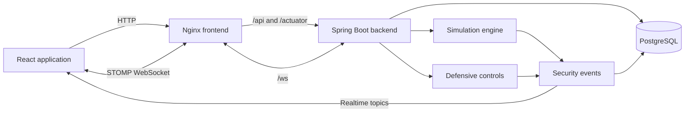

# HATCHLAB

[](https://github.com/kayquemigueldev/hatchlab/actions/workflows/ci.yml)

> A controlled authentication security laboratory for observing attacks, testing defenses, and understanding security telemetry.

HATCHLAB is a local educational environment that demonstrates how repeated password attacks behave, how authentication defenses react, and how security teams interpret the resulting evidence.

The complete learning cycle is:

**ATTACK → DETECTION → DEFENSE → OBSERVABILITY**

## Project status

HATCHLAB currently provides a functional local MVP. The core laboratory, defensive controls, real-time monitoring, comparison tools, educational views, automated tests, and containerized environment are implemented.

The project is currently entering its documentation, reliability, and release-preparation phase.

## Safety boundary

HATCHLAB is designed exclusively for authorized testing against its own local authentication environment.

The application does not support:

- Arbitrary or external targets
- Third-party authentication systems
- Leaked or imported credentials
- CAPTCHA bypass
- MFA bypass
- Rate-limit evasion
- External wordlists
- Attack traffic outside the local laboratory

All simulations use controlled test data bundled with HATCHLAB and target only the local laboratory account.

## Features

### Controlled attack simulation

- Simulates repeated password attempts against the local account
- Uses internal laboratory wordlists
- Supports configurable attempt limits
- Supports configurable delays between attempts
- Allows running simulations with or without defenses
- Allows active simulations to be stopped safely

### Defensive controls

- Rate limiting
- Progressive delay
- Account lockout
- Client throttling
- Suspicious login detection
- Security event logging

Each control includes a plain-language explanation describing what it observes, how it reacts, and what changes when it is enabled.

### Guided learning

- Beginner-friendly attack explanation
- Guided demonstration scenarios
- Live attack timeline
- Plain-language security event stories
- Educational “How It Works” walkthrough
- Technical views for deeper inspection

Available demonstration scenarios include:

1. Attack without defenses
2. Account lockout protection
3. Rate limiting protection
4. Layered defense protection

### Security comparison

HATCHLAB can compare equivalent baseline and protected simulations.

The comparison includes:

- Attempts processed
- Successful and failed attempts
- Blocked attempts
- Attack duration
- Success and blocking rates
- Defense impact
- Security score
- Risk classification
- Plain-language conclusions
- Downloadable experiment report

### Observability

- Searchable and paginated security events
- Real-time simulation updates
- Real-time security event updates
- Dashboard health indicators
- WebSocket connection status
- Simulation history
- Operational laboratory overview

### Laboratory management

- Controlled data reset
- Exact reset confirmation phrase
- Database migrations with Flyway
- Health checks for backend and database
- Docker Compose environment

## Interface

### Complete laboratory demonstration

Watch the complete reproducible workflow: laboratory reset, baseline attack, account-lockout protection, security comparison, report generation, and recorded telemetry.

[](docs/media/hatchlab-demo.webm)

_Click the image to open the recorded demonstration._

### Operational dashboard

Monitor laboratory health, simulation activity, defensive coverage, and recent security events.



### Guided attack visualization

Follow each controlled password attempt from the simulated attacker to the final authentication or defensive outcome.


### Security comparison

Compare equivalent baseline and protected simulations through scores, evidence, and plain-language conclusions.



### Security event story

Translate technical authentication telemetry into an understandable explanation of what happened and why it matters.



## Technology stack

### Backend

- Java 21
- Spring Boot 4
- Spring MVC
- Spring Security
- Spring Data JPA
- Jakarta Validation
- PostgreSQL 17
- Flyway
- WebSocket with STOMP
- Maven

### Frontend

- React 19
- TypeScript
- Vite
- React Router
- STOMP.js
- Vitest
- Testing Library
- Oxlint

### Infrastructure

- Docker
- Docker Compose
- Nginx
- Spring Boot Actuator

## Architecture



The frontend never receives an external attack target. Every simulation is executed internally by the Spring Boot application against HATCHLAB’s own authentication service.

## Requirements

The recommended installation method requires:

- Git
- Docker Desktop
- Docker Compose

For development outside Docker:

- Java 21
- Node.js 24 or newer
- npm

## Quick start

Clone the repository:

```bash
git clone https://github.com/kayquemigueldev/hatchlab.git
cd hatchlab
```

Create the local environment file:

```bash
cp .env.example .env
```

Start the complete stack:

```bash
docker compose up --build -d
```

Check the containers:

```bash
docker compose ps
```

Open the application:

```text
http://localhost:3000
```

Check the backend health endpoint:

```bash
curl http://localhost:8080/actuator/health
```

A healthy backend returns a response containing:

```json
{
  "status": "UP"
}
```

## Default laboratory account

The default local credentials are configured through `.env`:

```text
Username: admin
Password: HatchLab!2026
```

These credentials belong only to the controlled laboratory account. Change them in `.env` when necessary.

## Reproducible demonstration

Using the default HATCHLAB configuration, the following sequence produces a predictable baseline and protected comparison:

1. Open **Dashboard** and reset the laboratory using `RESET_HATCHLAB`.
2. Open **Attack Lab** and select **Attack without defenses**.
3. Prepare the scenario and set the delay to **100 ms**.
4. Start the simulation and wait for it to finish.
5. Confirm the baseline result:
    - Status: `SUCCESS`
    - Total attempts: `75`
    - Failed attempts: `74`
    - Successful attempts: `1`
6. Wait at least **11 seconds** so previous failures leave the defensive observation window.
7. Select **Account lockout protection**.
8. Prepare the scenario and set the delay to **100 ms**.
9. Start the protected simulation and wait for it to finish.
10. Confirm the protected result:
    - Status: `BLOCKED`
    - Total attempts: `4`
    - Failed attempts: `3`
    - Blocked attempts: `1`
    - Successful attempts: `0`
11. Open **Comparison** and compare the automatically selected sessions.
12. Confirm the final assessment:
    - Account outcome: `1 → 0`
    - Attempts prevented: `71`
    - Successful attempts reduced: `1`
    - Security score: `83 / 100`
    - Risk level: `LOW RISK`
13. Download the experiment report.
14. Open **Security Logs** and review the recorded attack and defense story.

The 11-second pause prevents failures from the baseline simulation from affecting the account-lockout result. This keeps the demonstration consistent when using the default configuration.
The complete preparation can also be automated while the containerized laboratory is running:

```bash
cd frontend
npm run demo:prepare
```

The command resets the laboratory, runs both simulations, validates their outcomes, and confirms the expected comparison score.

## Application pages

| Route | Page | Purpose |
| --- | --- | --- |
| `/` | Dashboard | Laboratory health, recent activity, metrics, and reset control |
| `/learn` | How It Works | Educational explanation of the complete security flow |
| `/attack` | Attack Lab | Controlled simulations and guided scenarios |
| `/defenses` | Defense Lab | Defensive control configuration |
| `/comparison` | Security Comparison | Baseline and protected simulation analysis |
| `/logs` | Security Logs | Searchable telemetry and plain-language security story |

## API overview

| Method | Endpoint | Purpose |
| --- | --- | --- |
| `POST` | `/api/v1/auth/login` | Authenticate against the local laboratory account |
| `GET` | `/api/v1/defense-config` | Read the current defensive configuration |
| `PUT` | `/api/v1/defense-config` | Update defensive controls |
| `POST` | `/api/v1/simulations` | Start a controlled simulation |
| `GET` | `/api/v1/simulations` | List and filter simulation history |
| `GET` | `/api/v1/simulations/{sessionId}` | Read one simulation |
| `POST` | `/api/v1/simulations/{sessionId}/stop` | Stop a running simulation |
| `GET` | `/api/v1/simulations/compare` | Compare baseline and protected sessions |
| `GET` | `/api/v1/security-score` | Calculate the score for a simulation pair |
| `GET` | `/api/v1/security-events` | Search and paginate security events |
| `POST` | `/api/v1/lab/reset` | Reset controlled laboratory data |
| `GET` | `/actuator/health` | Check backend health |

## Realtime channels

The backend exposes a STOMP WebSocket endpoint at:

```text
/ws
```

Available topics include:

| Topic | Purpose |
| --- | --- |
| `/topic/simulations` | General simulation updates |
| `/topic/simulations/{sessionId}` | Updates for one active simulation |
| `/topic/security-events` | Newly recorded security events |

When the realtime channel is unavailable, supported frontend flows fall back to regular API requests where applicable.

## Configuration

Runtime configuration is stored in `.env`.

Important groups include:

- PostgreSQL database and credentials
- Frontend and backend ports
- Local laboratory account
- Rate-limit threshold and window
- Account-lockout threshold and duration
- Progressive-delay limits
- Suspicious-activity threshold
- Client-throttling limits

Use `.env.example` as the reference configuration.

Do not commit the local `.env` file.

## Local development

Start only PostgreSQL:

```bash
docker compose up -d postgres
```

Run the backend:

```bash
cd backend
./mvnw spring-boot:run
```

In another terminal, run the frontend:

```bash
cd frontend
npm install
npm run dev
```

The Vite development server is available at:

```text
http://127.0.0.1:3000
```

It proxies API, health, and WebSocket requests to the backend at `127.0.0.1:8080`.

## Testing

### Backend

```bash
cd backend
./mvnw test
```

### Frontend

```bash
cd frontend
npm test
npm run build
npm run lint
```

The frontend suite covers API clients, dashboard state, attack guides, demonstration scenarios, defense controls, security stories, comparison insights, laboratory reset, and report generation.

## Stopping the environment

Stop the containers without deleting the database:

```bash
docker compose down
```

Stop the containers and permanently delete the local database volume:

```bash
docker compose down -v
```

The second command removes laboratory data and cannot be undone.

## Project structure

```text
hatchlab/
├── backend/
│   ├── src/main/java/com/hatchlab/
│   │   ├── authentication/
│   │   ├── comparison/
│   │   ├── defense/
│   │   ├── labreset/
│   │   ├── realtime/
│   │   ├── securityevent/
│   │   ├── securityscore/
│   │   └── simulation/
│   ├── src/main/resources/db/migration/
│   └── src/test/
├── frontend/
│   ├── src/app/
│   ├── src/features/
│   ├── src/shared/
│   ├── Dockerfile
│   └── nginx.conf
├── compose.yml
├── .env.example
└── README.md
```

## Current roadmap

The core laboratory is complete. The remaining work toward version 1.0
focuses on accessibility, reproducible demonstrations, presentation, and
release preparation.

### Core platform

- [x] Spring Boot backend and PostgreSQL persistence
- [x] Flyway database migrations
- [x] Controlled authentication and attack simulation
- [x] Internal laboratory wordlist
- [x] Configurable defensive controls
- [x] Security event recording and telemetry
- [x] Simulation comparison and security scoring
- [x] Realtime updates through WebSocket
- [x] Controlled laboratory reset

### Educational interface

- [x] Operational dashboard
- [x] Attack and defense laboratories
- [x] Security comparison and event logs
- [x] Educational How It Works walkthrough
- [x] Guided attack visualization
- [x] Guided demonstration scenarios
- [x] Plain-language defense explanations
- [x] Readable security event stories
- [x] Downloadable comparison report

### Testing and automation

- [x] Backend unit and integration tests
- [x] Frontend unit and component tests
- [x] End-to-end navigation coverage
- [x] End-to-end keyboard navigation coverage
- [x] GitHub Actions validation
- [x] Docker Compose validation in CI
- [x] End-to-end tests against the containerized stack

### Infrastructure and security

- [x] Containerized frontend, backend, and database
- [x] Service health checks
- [x] Services restricted to localhost
- [x] Non-root backend container user
- [x] Frontend security response headers
- [x] Dependency vulnerability review
- [x] Environment files excluded from version control
- [x] Configurable and synchronized laboratory credentials
- [x] Security and configuration review

### Documentation

- [x] Complete project documentation
- [x] Architecture and technology overview
- [x] Installation and configuration instructions
- [x] API and realtime channel overview
- [x] Local development and testing guide
- [x] Safety boundary and disclaimer
- [x] Interface screenshots
- [x] Continuous Integration badge

### Accessibility

- [x] Skip-to-content keyboard navigation
- [x] Visible keyboard focus
- [x] Identifiable main content on every page
- [x] End-to-end keyboard accessibility test
- [x] Review accessible names and descriptions
- [x] Announce loading, error, and result state changes
- [x] Respect reduced-motion preferences
- [x] Review text and state contrast
- [x] Add automated accessibility analysis
- [x] Validate complete keyboard-only workflows

### Reproducible demonstration

- [x] Guided attack scenarios
- [x] Predictable local laboratory credentials
- [x] Controlled data reset
- [x] Baseline and protected comparison workflow
- [x] Create a deterministic demonstration sequence
- [x] Automate demonstration preparation
- [x] Cover the complete scenario with Playwright
- [x] Document the expected result step by step

### Presentation and release

- [x] Main interface screenshots
- [x] Record a demonstration video or GIF
- [x] Add the demonstration media to the README
- [ ] Prepare a concise portfolio description
- [ ] Complete final project validation
- [ ] Create a changelog
- [ ] Create the `v1.0.0` tag
- [ ] Publish the versioned GitHub release

The recommended completion order is accessibility, reproducible demonstration,
presentation media, and finally the version 1.0 release.

## Contributing

Keep every contribution inside HATCHLAB’s local and educational safety boundary.

Before opening a pull request:

1. Create a focused branch.
2. Keep changes limited to one objective.
3. Add or update tests.
4. Run backend and frontend validation.
5. Document behavior changes.
6. Never add external attack targets or evasion features.

## Disclaimer

HATCHLAB is an educational software project for controlled local experimentation. It must not be used against systems, accounts, or services without explicit authorization.
